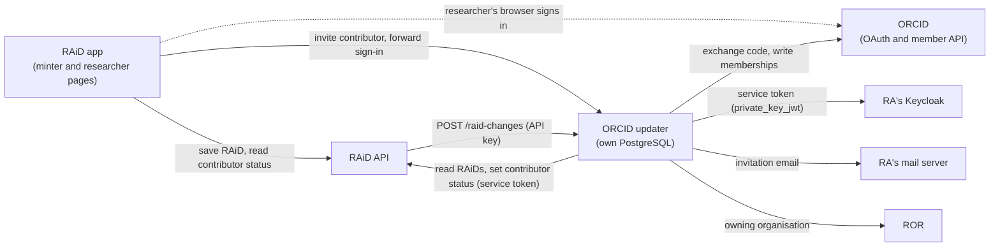
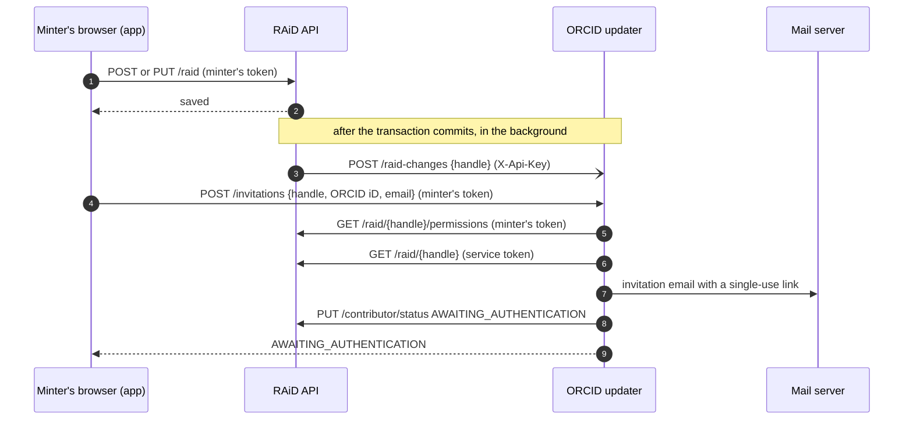
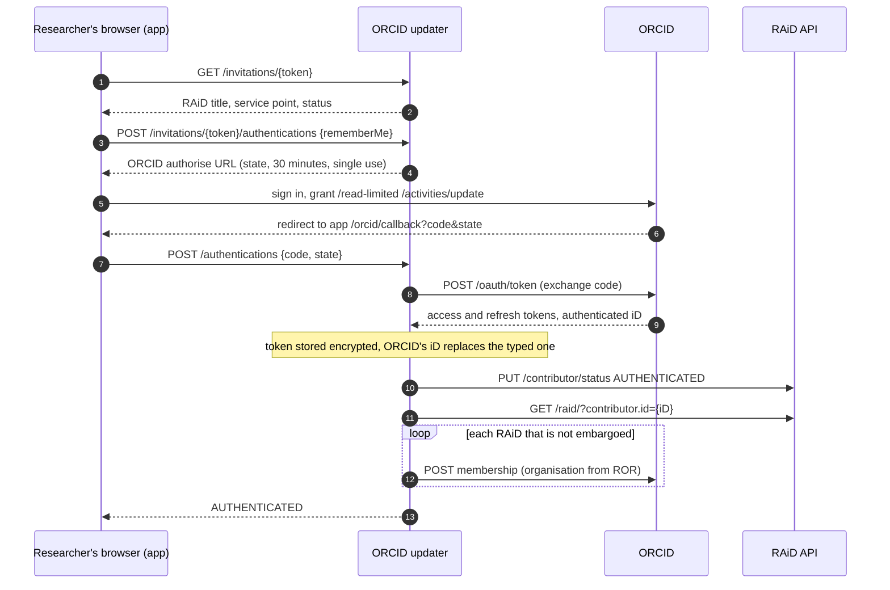
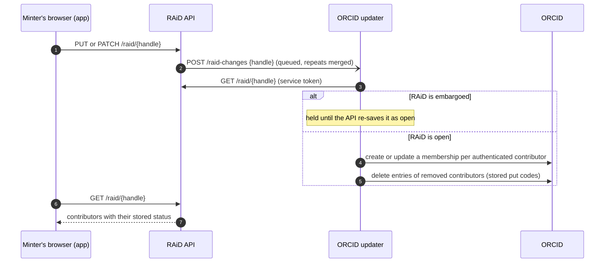

# How the RAiD app, API, ORCID updater and ORCID communicate

Each registration agency (RA) runs its own [ORCID updater](../../orcid-updater/README.md).
It is the only part of RAiD that holds researchers' ORCID tokens and writes to
ORCID records. The RAiD API never talks to ORCID about researchers' records, and
the RAiD app never holds an ORCID token.

The updater's endpoints are defined in its
[API contract](../../orcid-updater/idl/orcid-updater-openapi-3.1.yaml). The
design decisions are in the
[ADR](../adr/2026-10-23_per-ra-orcid-updater.md).

## Who calls whom

Browser calls to the updater are allowed only from the RA's app origin.

## A minter saves a RAiD and invites a contributor

- The API tells the updater about every mint, update and patch. A failed call
  is logged and the save still succeeds; the next save tells the updater again.
- The email is used only to send the invitation and is never sent to the API.
  The updater stores only a keyed hash of it, for "Remember me".
- No new email is sent while an invitation for the same iD is still valid, or
  when a researcher who ticked "Remember me" matches the email.

## The researcher authenticates their ORCID iD

- `PUT /contributor/status` gives every RAiD naming the contributor a new
  version holding the status. DataCite isn't called: every contributor is a
  creator on the DOI whatever their status, so the DOI doesn't change.
  Repeating the call changes nothing, so the updater can retry after a
  failure.
- Mint, update and patch ignore any status the client sends and use the
  stored one, UNAUTHENTICATED for a contributor the API hasn't seen.
- ORCID sends the researcher back to the app, so each app's
  `<app URL>/orcid/callback` must be registered as a redirect URI on the RA's
  ORCID member client.
- If the researcher declines (`error=access_denied`), the updater stores
  nothing.

## A later save keeps ORCID records up to date

## What each call carries

| Caller → callee | Credential |
|---|---|
| API → updater | Shared API key in `X-Api-Key` |
| Minter's browser → updater | Minter's Keycloak access token. The updater checks the minter can edit the RAiD. |
| Researcher's browser → updater | None. Protected by the single-use invitation token and the OAuth state. |
| Updater → API | Service token for the updater's Keycloak client (`contributor-writer` role), got with `private_key_jwt`. Keycloak reads the public key from `/.well-known/jwks.json`, so the client has no secret. |
| Updater → ORCID | The RA's ORCID member client for the code exchange, then the researcher's stored token for writes. |
| RA administrators → updater | Token with the `orcid-updater-admin` role, for deleting a researcher's data and importing put codes. |
